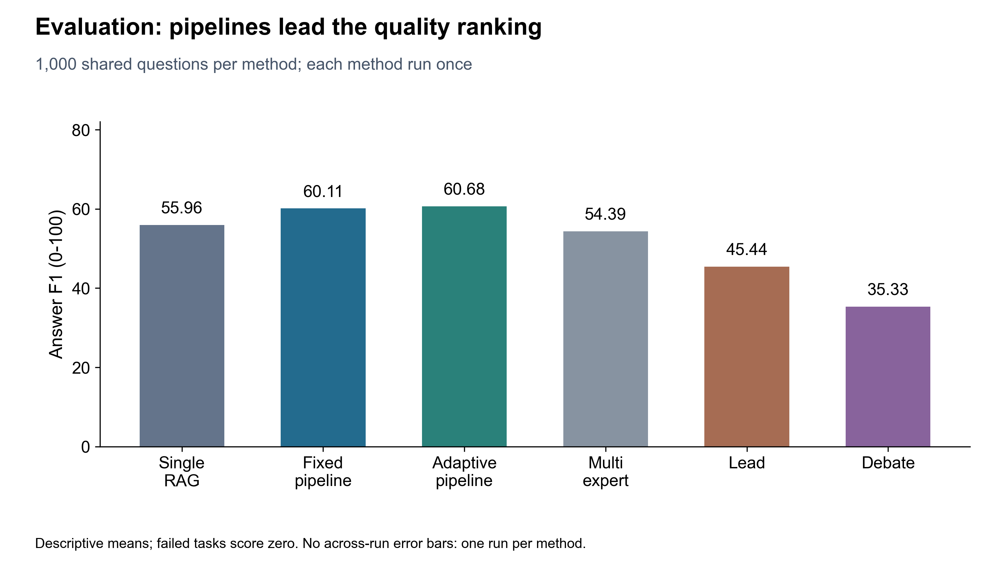
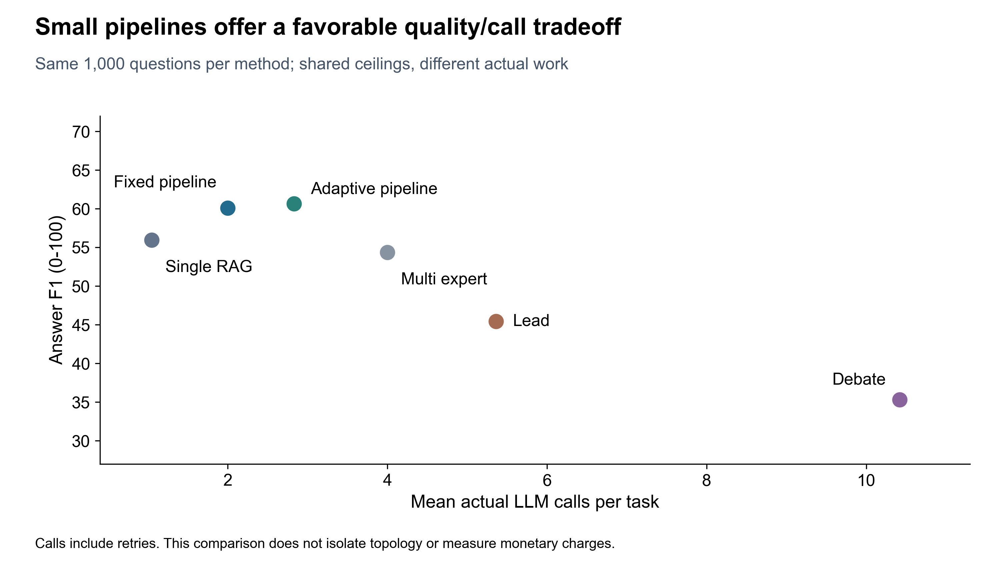
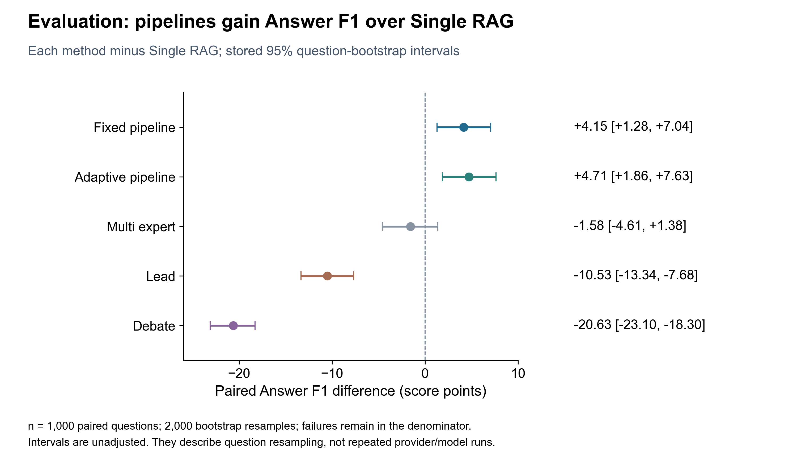
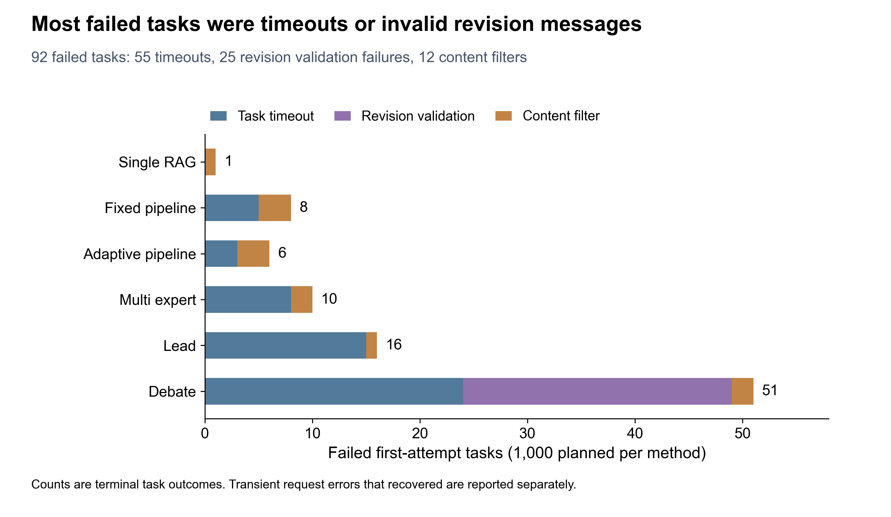

# 六种问答协议的正式评价结果分析

分析日期：2026-10-29。本报告基于 `baseline-evaluation-001` 的冻结首次尝试，使用已生成的汇总、6,000 条逐题记录、只读运行数据库和 92 项失败运行的诊断。没有补跑、删题、重抽划分或改写原实验档案。

**主要结论：在当前模型、HotpotQA 内部保留评价集和共同资源上限下，两种流水线具有较好的答案/证据质量与开销折中。自适应流水线的均值略高，但尚无清晰证据支持其优于固定流水线；更复杂的多专家、Lead 和 Debate 未带来对应的答案质量收益。**

## 1. 这轮实验在比较什么

- 数据：公开 HotpotQA dev-distractor 的固定内部评价划分，1,000 题，800 bridge、200 comparison；不是官方隐藏测试集。
- 方法：single_rag、pipeline_fixed、pipeline_adaptive、multi_expert、lead、debate；同题配对比较，每题每方法一次，共 6,000 项首次尝试。
- 控制：deepseek-v4.1-flash、temperature=0、单次最大输出 4,096 tokens；同一检索实现，每个子问题 top_k=3；多专家模板两位专家串行执行；Lead/Debate 两轮。
- 共同上限：单题 60 节点、40 次模型调用、600 秒总时限、120 秒节点时限。结构输出最多追加两次修正，可恢复请求错误最多追加一次。
- 统计单位：1,000 个配对问题，不是 6,000 个独立问题或 25,652 个独立模型请求。只有一次真实运行，不报告跨 seed/重复运行标准差。
- 评分：首次失败保留、计零；completed 是流程状态，不等于答案正确；EM/F1、SP/Joint 分别衡量答案、支持证据及二者联合质量。

模型输入不含标准答案和支持事实标签。六方法实际检索量、调用量和上下文不同，因此这是共同上限下的端到端比较，不是等实际费用、等检索量或单因素因果实验。

任务执行始于北京时间 2026-10-28 13:16，结束于 2026-10-29 07:18，执行会话约 18 小时 2 分 13 秒；最终报告约 07:23 生成。6,000 项均有终态：5,908 completed、92 failed，完成率 98.47%；没有取消、中断、未开始项或任务级补跑。

## 2. 总体结果

质量分数统一乘 100。平均调用与平均耗时都包含失败任务和内部重试。

| 方法 | 完成/1,000 | EM | Answer F1 | SP F1 | Joint F1 | 平均模型调用 | 平均耗时/秒 |
| --- | ---: | ---: | ---: | ---: | ---: | ---: | ---: |
| single_rag | 999 | 43.80 | 55.96 | 57.18 | 36.77 | 1.046 | 2.21 |
| pipeline_fixed | 992 | 48.50 | 60.11 | 70.41 | 48.57 | 1.999 | 4.21 |
| pipeline_adaptive | 994 | **48.80** | **60.68** | **70.45** | **48.83** | 2.829 | 5.87 |
| multi_expert | 990 | 44.10 | 54.39 | 69.31 | 43.82 | 3.998 | 8.40 |
| lead | 984 | 35.30 | 45.44 | 60.52 | 34.05 | 5.363 | 13.29 |
| debate | 949 | 26.80 | 35.33 | 55.95 | 25.31 | 10.417 | 30.10 |

图示为六种协议在相同 1,000 道正式评价题上的平均 Answer F1，失败任务按零分保留。每题每方法只运行一次，因此没有绘制跨重复运行误差条；同题配对差值及其按题 bootstrap 区间见第 3 节。自适应均值略高不代表已证明优于固定流水线。

### 2.1 两种流水线是本轮较好的质量—开销折中

固定流水线相对单智能体，Answer F1 高 **4.15** 分，EM 高 **4.70** 个百分点，SP F1 高 **13.23** 分，Joint F1 高 **11.80** 分。其均值收益在证据和联合指标上尤其明显。

自适应流水线相对单智能体，Answer F1 高 **4.71** 分，Joint F1 高 **12.06** 分。两种流水线都值得保留；如果侧重简单、稳定和开销，固定流水线是合理的后续开发基线，单智能体则保留为低开销参照。

### 2.2 自适应的“排名第一”不等于已证明更好

自适应比固定只多命中 **3/1,000 题**：EM 差 0.30 个百分点；Answer F1 差 **0.56** 分，Joint F1 差 **0.26** 分。与此同时，平均模型调用增加 **41.5%**，平均耗时增加 **39.5%**，耗时 P95 为固定流水线的 **2.30 倍**。

这支持“当前反馈机制增加了开销，但额外收益有限”的判断。它不证明反馈普遍无效，也不能把未检出清楚差异解释为两方法等效。

### 2.3 多专家改善了证据指标，却没有明确提高答案 F1

多专家相对单智能体的 EM 只高 0.30 个百分点，Answer F1 反而低 1.58 分；这一 F1 差值区间跨零，不能断言它总体更差。SP F1 高 12.13 分、Joint F1 高 7.05 分，说明“答案是否命中”和“最终证据是否匹配”需要分开看。

相对固定流水线，多专家平均调用约两倍，主要质量指标均更低。因此本轮不支持仅靠增加同模型专家数量改善答案质量。尚不能把差距单独归因于专家数量，规划、检索、汇总策略都同时参与了比较。

### 2.4 Lead、Debate 的当前实现没有体现开销收益

Lead 的 Answer F1 为 45.44，低于单智能体 10.53 分；Debate 为 35.33，低 20.63 分。Debate 平均调用为固定流水线的 **5.21 倍**、平均耗时为其 **7.16 倍**，且完成率最低，为 94.9%。

这些结论限定在当前实现、模型和数据设置，不能推导为“所有 Lead/Debate 方法都无效”。后续重点应是找出有效证据获取、修订约束和停止规则的问题，而非直接增加回合。

## 3. 同题配对结果与不确定性

使用启动前方案指定的 2,000 次按题 bootstrap。下表方向均为“该方法减 single_rag”，单位是 0—100 尺度的 Answer F1 分差；区间直接读取冻结报告，没有重新挑选 seed。

| 方法相对 single_rag | 平均差 | 95% 按题 bootstrap 区间 |
| --- | ---: | --- |
| pipeline_fixed | +4.15 | [+1.28, +7.04] |
| pipeline_adaptive | +4.71 | [+1.86, +7.63] |
| multi_expert | -1.58 | [-4.61, +1.38] |
| lead | -10.53 | [-13.34, -7.68] |
| debate | -20.63 | [-23.10, -18.30] |

固定与自适应的直接比较，Answer F1 差值（自适应减固定）为 **+0.56，95% 区间 [-0.88, +1.97]**。1,000 题中，自适应 F1 更高 51 题、相同 906 题、更低 43 题；EM 则为 30 胜、943 平、27 负。

两条流水线相对单智能体的区间都位于零以上，为本轮质量增益提供支持；但这些区间没有进行多重比较校正，不能据此宣称所有比较同时得到统计确认。它们仅反映这批题的重采样，不包含模型/供应商多次运行的随机性。报告不新增 p 值，也不把“不显著”写成“等效”。

## 4. 92 项失败究竟是什么

失败分布涉及 81 个不同问题。同题在不同方法失败分别计任务；内容审核、超时和输出校验按最终失败原因互斥归类。

| 方法 | 内容审核拦截 | 协议任务超时 | 修订消息校验耗尽 | 合计 |
| --- | ---: | ---: | ---: | ---: |
| single_rag | 1 | 0 | 0 | 1 |
| pipeline_fixed | 3 | 5 | 0 | 8 |
| pipeline_adaptive | 3 | 3 | 0 | 6 |
| multi_expert | 2 | 8 | 0 | 10 |
| lead | 1 | 15 | 0 | 16 |
| debate | 2 | 24 | 25 | 51 |
| 合计 | **12** | **55** | **25** | **92** |

**只有 12 项是供应商明确的内容审核拦截，占全部任务 0.20%、失败任务约 13.0%。不能把 92 项失败都解释为“百炼拦截”。**

### 4.1 12 项内容审核拦截

日志明确保存 HTTP 400、`data_inspection_failed` 和 Request ID。拒绝发生在规划、初始提案、主导、修订或审核等不同阶段。这能确定供应商内容检查拒绝了请求，不能确定具体哪段输入触发了规则，也不应仅根据任意历史 HTTP 400 推断同一原因。

### 4.2 55 项任务触及节点时间约束

失败信息均为“协议任务超过时间上限”。按失败节点的开始与运行失败时刻核对，耗时约 **120.97—121.18 秒**，中位数 **121.05 秒**，与 120 秒节点上限及请求重试等待/收尾开销相符。逐请求记录同时保存了 timeout 异常。

发生阶段包括 critique 9、revise 11、review 15、work 8、coordinate 5、opinions 3、plan 3、initial 1。单智能体未出现最终超时；长协作链具有更多请求暴露机会，但日志不足以将超时具体归因于供应商排队、网络或本机负载。

这类失败不等于“单题总执行到了 600 秒”，也不应未经验证就盲目提高所有预算。后续应在开发数据上单独检查超时分布、请求超时与节点时限的关系。

### 4.3 25 项都是 Debate 的修订阶段校验失败

25 项全部发生在 `revise`，其中 experts_0 为 21 项、experts_1 为 4 项。每项失败前的最后三次调用均为 **invalid_schema**，结束原因是 stop；即得到完整模型响应后，初始输出和两次修正仍未通过字段或业务规则校验。这些不是 HTTP 内容审核拒绝，也不是输出到 Token 上限后被截断。

当前保存的校验详情都只有 `$ / invalid_schema`，无法定位到某个具体字段或某一条回应/引用规则。代码可能拒绝回应 ID 不匹配、缺少可追溯引用等多种业务约束，但不能从现有日志断言是哪一条。原始无效回复没有归档，不能靠猜测恢复。

原自动标签没有完整体现这类异常；本报告依据节点状态和逐调用诊断补充分组，不改变主报告的首次分数。后续版本应完善业务校验错误的标识和字段位置，并在开发集验证，不覆盖本轮结果。

### 4.4 请求错误与最终失败要分别统计

逐请求共有 **95 条请求错误**：55 条 timeout、12 条内容审核、9 条 HTTP 503 / ServiceUnavailable、19 条 HTTP 500 / internal_server_error。28 条 500/503 所在任务重试后完成，归入 completed，不计入 92 项最终失败。

全量调用记录另有 590 条 invalid_schema、30 条 invalid_citation；它们是调用级诊断，很多经内部修正后流程完成，不能直接加成 620 项失败。

## 5. 失败不能解释全部质量差距

保持其他结果不动，仅作极端数学上限假设：如果 Debate 的 **51 项失败全部拿到 F1 满分**，总平均 F1 最多从 **35.33 升到 40.43**，仍低于固定流水线 60.11；EM 也最多从 26.80 升到 31.90，低于固定流水线 48.50。

这不是补跑结果，也没有改写任何分数。它说明 Debate 的低分还大量存在于已经 completed 的任务中，不能只归因于超时或校验失败。

作为补充敏感性观察，六方法都完成的共同子集为 **919 题**，Answer F1 分别为：single_rag 57.06、固定 61.27、自适应 61.37、多专家 55.43、Lead 46.96、Debate 37.66，主线没有反转。但此子集按运行结果事后筛选，有选择偏差，只作诊断，不能替换原 1,000 题主表。

## 6. 为什么复杂协作没有带来收益：目前有哪些证据

### 6.1 规划与检索覆盖是较具体的收益路径

平均检索支持事实覆盖率：single_rag 53.95%（999 项可计算）、固定 74.22%（996）、自适应 74.40%（999）、多专家 74.03%（997）、Lead 60.47%（991）、Debate 53.93%（998）。这是各题覆盖比例的均值，不是完整检索成功题占比；缺少可靠映射的项没有记成零。

固定/自适应/多专家在证据覆盖上接近，且高于直接按原题检索的单智能体。这与规划子问题改变检索方向的作用一致，但总检索量、输入材料和审核方式同时变化，不能视为对“规划”单一因素的因果证明。

### 6.2 自适应有额外检索，平均新增覆盖有限

自适应初始覆盖 73.69%，累计覆盖 74.40%，增加约 **0.71 个百分点**；272 项带有后续检索没有新增证据的轨迹标签。该标签不表示每次补检索都没有效果，也不能将累计覆盖变化与答案质量变化直接等同。

这为“当前反馈步骤经常重复已有材料，额外收益较小”的假设提供线索。Lead 的平均覆盖从 56.67% 到 60.47%，虽有增加，仍低于两种流水线；仅增加检索动作没有转化为整体答案优势。

### 6.3 Debate 大量回合没有补足关键事实

Debate 初始与累计支持事实覆盖均为 53.93%；997 项带有后续检索无新增证据的轨迹标签。**580 项按 max_visits 结束，全部最后完成节点都是 reviewer_0**。因此不能说“580 项崩溃”或“没有执行最终审核”。Lead 的 7 项触限同样执行过最终审核。

这与“基于相同或未补齐的证据反复讨论，难以补足关键事实”的解释相符。它仍只是轨迹支持的机制假设，需要在开发集上对证据预算、反馈和停止规则做消融。

### 6.4 空答案、证据不足、verified 和正确性应分开

| 方法 | completed 中的空字符串答案 | 全部空字符串答案 | max_visits |
| --- | ---: | ---: | ---: |
| single_rag | 123 | 124 | 0 |
| pipeline_fixed | 257 | 265 | 0 |
| pipeline_adaptive | 241 | 247 | 0 |
| multi_expert | 195 | 205 | 0 |
| lead | 265 | 281 | 7 |
| debate | 231 | 274 | 580 |

这里仅统计空字符串，不能当作完整弃答率。Debate 另有 197 项答案为字面 `insufficient`，还有其他无法确定表述。失败时也可能留下中间的非空答案，仍按失败计零。

固定流水线 719 项被内部审核标为 verified，其中 **242 项没有达到答案 EM**；自适应为 735 项 verified、255 项 EM 未命中；Debate 为 369 项 verified、158 项 EM 未命中。EM 未命中可能涉及错误、别名或表述差异，不能直接当作人工确认的事实错误，但足以表明 verified 不能代替外部评分。

## 7. 一个能讲清楚收益路径的真实案例

样本 `5a7147fd5542994082a3e758`：**“最早在哥本哈根开始铸币的国王，出生日期是什么？”** 标准答案为 **2 February 1455**。

- 单智能体找到铸币者是 King Hans，但没有找到出生日期，答 Unknown。
- 固定流水线拆为“是哪位国王”与“这位国王何时出生”，检索到 Royal Mint 与 John, King of Denmark 两处材料。后者明确说明 John 即 Hans，并给出出生日期，最终答案和引用都对齐。
- Debate 找到 King Hans 的材料后，后续仍未补出出生日期，最终以证据不足空答，流程 completed。

该例说明有效的子问题检索可以补齐第二跳事实；并不说明每个问题都适合流水线。反例也保留：样本 `5a71214d5542994082a3e5b9` 中 Debate、单智能体等正确回答 Los Angeles Dance Theater，而两种流水线为空。案例是有目的的机制说明，不能当作总体发生频率。

## 8. 分题型结果

| 方法 | bridge Answer F1（800 题） | comparison Answer F1（200 题） |
| --- | ---: | ---: |
| single_rag | 53.67 | 65.14 |
| pipeline_fixed | 57.30 | 71.39 |
| pipeline_adaptive | 58.45 | 69.58 |
| multi_expert | 51.58 | 65.61 |
| lead | 42.83 | 55.86 |
| debate | 36.21 | 31.81 |

固定与自适应在两类题上的均值顺序不同，进一步说明总榜第一不代表每类问题最优。分层比较是探索性结果，不能根据“某层区间跨零、另一层不跨零”就宣称存在类型交互；本报告没有新增交互检验。

## 9. 与开发实验对照

| 方法 | 开发集 F1（100 题） | 正式评价 F1（1,000 题） |
| --- | ---: | ---: |
| single_rag | 58.87 | 55.96 |
| pipeline_fixed | 64.81 | 60.11 |
| pipeline_adaptive | 64.34 | 60.68 |
| multi_expert | 62.21 | 54.39 |
| lead | 50.01 | 45.44 |
| debate | 35.49 | 35.33 |

“两条流水线较好、Lead/Debate 当前表现较弱”的主线在保留评价中重现。多专家在开发集的答案均值优势没有在这轮评价中重现；不能把开发 100 题排名视为稳定结论。

两轮使用不同题目、不同时间与样本量，不是同题前后对照；不能把分数差称为模型性能随时间下降。正式评价平均耗时更低，也不能据此宣称执行器提速：运行时段、网络、供应商延迟和本机负载都可能不同，本轮还经历了前端验证，耗时是实际观测而非独立纯模型基准。

## 10. 开销与账单边界

本轮记录 **25,652 次模型调用**。整题汇总有 5,905/6,000 项的完整 Token 记录，合计已知 **76,852,046 tokens**；95 项的完整用量未知。

把这些未知整题中已知的单次响应也计入，逐调用已知用量为 **78,404,790 tokens**（输入 72,018,536、输出 6,386,254），已知记录 25,557/25,652；其余 95 次调用未知。两种总量采用不同汇总分母，因此并不矛盾，后者也不是完整实际账单。

平均/中位/P95 任务耗时如下，单位秒：

| 方法 | 平均 | 中位数 | P95 |
| --- | ---: | ---: | ---: |
| single_rag | 2.21 | 1.86 | 3.71 |
| pipeline_fixed | 4.21 | 3.18 | 5.27 |
| pipeline_adaptive | 5.87 | 3.41 | 12.14 |
| multi_expert | 8.40 | 6.73 | 14.18 |
| lead | 13.29 | 9.87 | 24.60 |
| debate | 30.10 | 27.84 | 58.08 |

不能把调用次数、Token 或总上限直接换成实际扣款；本报告没有查询账单或估计人民币金额。

## 11. 结果可以怎样表述，下一步做什么

可以用于组会的表述：

> 我完成了六种问答协议在同一批 1,000 道保留问题上的正式评价，共 6,000 项首次尝试。固定与自适应流水线在当前设置下表现出较好的质量—开销折中，相对单智能体的答案 F1 均值分别提高约 4.15 和 4.71 分，证据及联合指标的提升更明显。但自适应相对固定只高 0.56 分，配对区间跨零，而调用量增加约 41.5%，还不能认为它有明确额外优势。复杂协作没有自动带来更好答案。失败主要是节点超时和辩论修订校验耗尽，内容审核拦截只占 12 项；即便极端假设所有 Debate 失败都满分，也解释不了其全部质量差距。后续应围绕有效证据、修订约束和停止规则开展开发集消融。

接下来的优先事项：

1. 固定本轮报告和首次成绩，不为了改善排名选择性补跑；若明确复验，另记尝试和补充统计。
2. 人工核查超时代表例、25 项修订失败和 verified/EM 不一致样本。修订业务规则的精确诊断是日志下一版的优先项，不假装现有记录已经能定位全部具体字段。
3. 以固定流水线和单智能体为主要参照，在开发集上比较相同总证据预算、反馈触发和停止规则；新的运行条件另立版本。
4. 研究汇报区分工程平台、当前基线比较和新机制贡献。本轮不证明某个新算法创新、所有模型的普适排序或单一协作因素的因果效应。
5. 当前评价结果已经查看，后续不能一边反复据此调参，一边继续称这 1,000 题为未接触的测试证据。

## 12. 文件与核对范围

- `analysis.json`：逐题复核后的汇总、原始配对区间、分题型、错误阶段、案例及敏感性分析。
- `failures.csv`：92 项失败的样本/运行 ID、类别、阶段、请求诊断和最后三次校验信息。
- `analyze_evaluation.py`：只读分析脚本，不调用模型；`plot_evaluation.py`：从已核对汇总作图。
- `figures/`：四张图的 PNG/PDF/SVG、字体/碰撞/对齐审核；`figure-notes.md`：统计和导出边界。
- `archive-integrity.json`：24 份关键文件分析前后的 SHA-256 一致，包括原始报告、任务/运行数据库、清单、配置、方法定义和源码归档。

本次只增加分析材料；没有修改执行源码、原始实验记录、评分代码或项目依赖，也没有追加真实模型请求。
