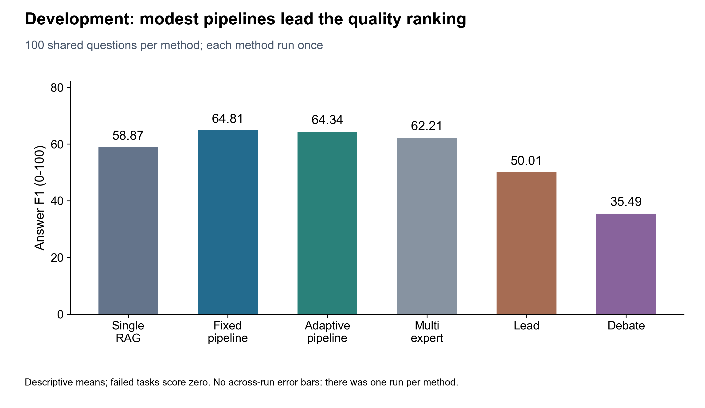
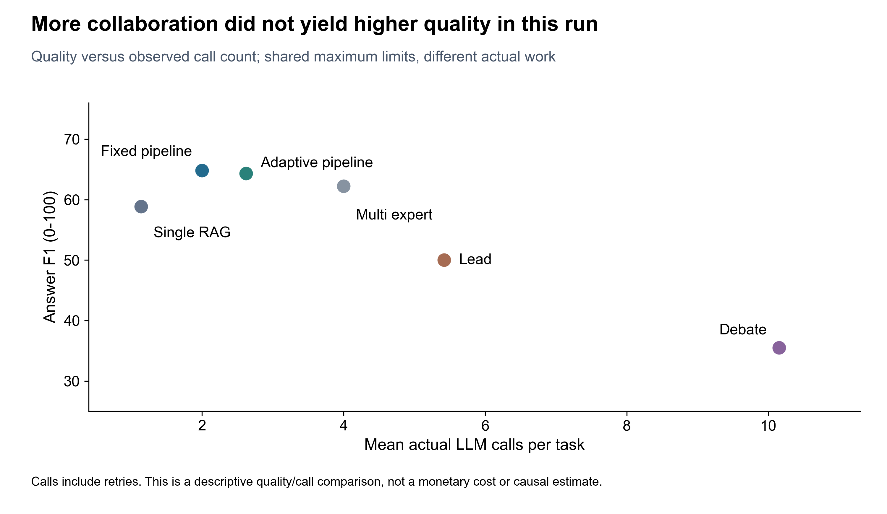
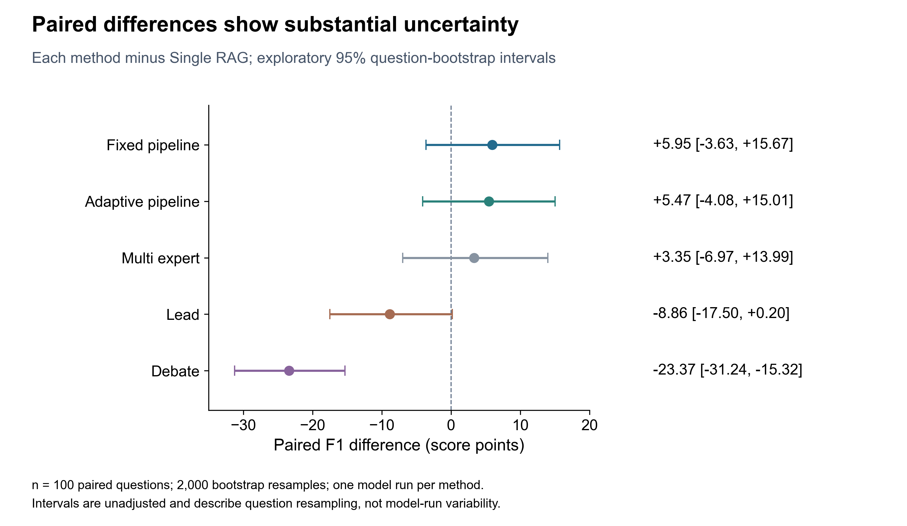

# 组会汇报：六种多智能体问答协议的开发实验

适用日期：2026-10-29。建议主讲 10—12 分钟，按下列八个部分讲述。全部定量结果来自已完成的 100 题开发实验；进行中的正式评价不纳入本稿结论。

**汇报主线：已经把六种可配置协议放进同一套可追溯实验流程；开发结果提示，当前设置下适度的规划与审核比更复杂的协作更划算，但优势的稳定性和原因仍需独立评价与后续消融验证。**

## 第 1 部分：这次实验究竟要回答什么（约 1 分钟）

可直接讲：

> 上次组会以后，我把系统的批量评测能力补上了，同时完成了一轮六种问答协议的开发实验。这次主要不是证明“智能体越多越好”，而是想回答：在同一个模型、同一批问题和共同资源上限下，增加规划、反馈、专家汇总、主导调度或辩论之后，回答质量是否提高，提高多少，又增加了多少实际调用和耗时，以及错误主要集中在哪里。
>
> 因为这些协议本身包含的检索和协作步骤不同，所以这是一项端到端质量、开销和可靠性比较，不能把所有差异单独归因于协作拓扑，也不是等实际调用次数或等费用的比较。

强调：任务能力、工程能力和研究证据分开陈述。配置驱动系统、可追溯批量评测属于工程能力；本轮数据提供开发阶段的比较证据；尚不能仅凭这一轮就宣称已经验证新的协同算法贡献。

## 第 2 部分：六种方法分别怎样工作（约 1.5 分钟）

| 方法 | 本轮实际流程 | 主要比较点 |
| --- | --- | --- |
| single_rag | 一个专家直接针对原问题检索、回答并给出引用 | 最简参照，观察协作带来的额外收益和代价 |
| pipeline_fixed | 规划子问题 → 按子问题检索 → 审核并生成最终答案 | 一次性规划与证据汇总 |
| pipeline_adaptive | 固定流水线 + 证据不足时补检索、冲突时重规划 | 有界反馈是否有效 |
| multi_expert | 规划 → 两位专家独立提案 → 统一审核 | 本轮保留规划节点，两专家串行执行 |
| lead | 主导者选择专家、分派任务 → 汇总后审核 | 动态分工是否带来额外收益 |
| debate | 两位专家独立提案 → 相互质疑 → 修订 → 审核裁决 | 有界辩论是否改善质量；未通过时可进入下一轮 |

可直接讲：

> 六组都复用现有 RunService 和协议执行器，不是为了实验重新写六套答案程序。单智能体是最简参照；固定流水线增加任务拆解和审核；自适应流水线在此基础上允许反馈。多专家先分别回答再统一审核；Lead 由主导节点决定分工；Debate 则显式执行提案、质疑、修订和裁决。本轮多专家使用相同模型，专家执行方式固定为串行，Lead 和 Debate 的回合上限都是两轮。

不要说“六种方法是六个不同模型”，也不要说本轮测试了所有串并行组合。这里改变的是协议及其端到端执行流程。

## 第 3 部分：数据、控制条件与规模（约 1.5 分钟）

HotpotQA 是包含多跳问题和句级支持事实的公开问答基准；distractor 设置为每题给定 10 段候选材料，同时评价答案和支持证据。本轮在题目提供的 context 内检索，不是全维基开放检索。[HotpotQA 官方说明](https://hotpotqa.github.io/)、[原始论文](https://aclanthology.org/D18-1259/)。

| 项目 | 本轮设置 |
| --- | --- |
| 数据来源 | HotpotQA 公开 dev-distractor；原 7,405 条中预先剔除 1 条支持句坐标非法记录，固定 QC 文件为 7,404 条 |
| 开发样本 | 100 道题，80 道 bridge、20 道 comparison，种子 42、按题型比例抽样 |
| 条件与任务量 | 同一批题配对比较六种方法，每题每方法运行一次，共 600 项首次尝试 |
| 模型 | 全部使用 deepseek-v4.1-flash，temperature=0，最大单次输出 4,096 tokens |
| 检索 | 同一 BM25 句级检索实现，每个子问题 top_k=3 |
| 协作规模 | 多专家模板使用两名专家，串行执行；Lead / Debate 两轮 |
| 单题共同上限 | 60 次节点调用、40 次模型调用、600 秒总时限、120 秒节点时限 |
| 重试 | 最多两次结构输出修正；可重试的瞬时请求错误最多追加一次，全部计入调用与开销 |
| 标签隔离 | 模型只读取该题问题与 context；标准答案和 supporting_facts 留在评分侧 |

**这里的样本分析单位是 100 个问题，同题六种条件；不是 600 个独立样本，更不是 2,533 次独立实验。**

可直接讲：

> 这轮选择 100 道题做开发诊断，每种方法跑同样的问题，形成 600 条首次尝试。我们固定模型、温度、检索实现和资源上限，并且把标准答案与支持事实从运行输入中隔离。要特别说明，top_k=3 是每个子问题的检索条数。规划器可能把原题拆成多个子问题，所以各方法最终读取的总证据量不一定相等，这也是本轮只能做端到端比较的原因。

两轮 smoke 用于前期流程验证，不与本表混合累计。保留的 1,000 题评价集来自公开 dev 数据中的另一部分，与已登记的新旧开发集及已知曝光范围分离；不是 HotpotQA 官方隐藏测试集。

## 第 4 部分：指标如何解释（约 1 分钟）

| 指标 | 直观含义 | 需要避免的误解 |
| --- | --- | --- |
| Answer EM | 归一化后的答案是否与标准答案完全一致 | 55 表示 55/100 题命中；不等于系统自报 verified |
| Answer F1 | 答案词元重叠的精确率和召回率的调和平均 | 64.81 是平均得分，不是“64.81 道题完全正确” |
| SP F1 | 预测支持句与标注支持句集合的匹配质量 | 衡量最终引用，与检索候选覆盖率不同 |
| Joint F1 | 联合考虑答案与支持事实 | 由答案/证据 precision 与 recall 联合计算，不是直接把两个 F1 相乘 |
| 完成率 | 流程是否到达 completed 终态 | completed 的答案仍可能不正确或为空 |
| 开销 | 实际调用次数、Token、任务耗时 | 共同上限不代表实际费用相等；未知用量不记零 |

答案归一化、支持句集合匹配和 Joint 指标的含义已对照 [HotpotQA 官方评测脚本](https://raw.githubusercontent.com/hotpotqa/hotpot/master/hotpot_evaluate_v1.py) 核对；本轮运行失败保留并计零的处理由实验报告器执行。

可直接讲：

> 我同时看答案和证据。EM 是严格命中，F1 对部分正确答案给部分分，SP F1 看引用证据，Joint F1 看两者结合。主表保留所有首次尝试，失败也留在分母里并计零，避免把失败题删除后让成绩变好。下面的质量分数都乘了 100，变化用评分点或百分点表达。

## 第 5 部分：主要结果与质量—开销取舍（约 2 分钟）

| 方法 | 完成/100 | EM | Answer F1 | SP F1 | Joint F1 | 平均实际调用 | 平均耗时/秒 |
| --- | ---: | ---: | ---: | ---: | ---: | ---: | ---: |
| single_rag | 100 | 49.00 | 58.87 | 57.63 | 39.98 | 1.14 | 4.24 |
| pipeline_fixed | 100 | 55.00 | **64.81** | **74.30** | 52.47 | 2.00 | 6.06 |
| pipeline_adaptive | 99 | 55.00 | 64.34 | **74.30** | **52.81** | 2.62 | 9.34 |
| multi_expert | 100 | 54.00 | 62.21 | 73.92 | 49.91 | 4.00 | 12.93 |
| lead | 100 | 39.00 | 50.01 | 62.99 | 36.60 | 5.42 | 18.71 |
| debate | 98 | 29.00 | 35.49 | 59.14 | 27.82 | 10.15 | 43.83 |

总计 597 项 completed、3 项 failed，完成率 99.5%；实际记录模型调用 2,533 次，整批约 2 小时 41 分钟。两项任务的总 Token 用量未知，不能把已知总量当作完整账单。

可直接讲：

> 第一，当前开发设置下，固定流水线的答案 F1 最高，为 64.81，单智能体是 58.87，平均相差约 5.95 个评分点。它的证据 F1 也从 57.63 提高到 74.30，Joint F1 从 39.98 提高到 52.47。
>
> 第二，自适应流水线与固定流水线非常接近。答案 F1 低约 0.47 点，Joint F1 高约 0.34 点，但调用多了 31%，平均耗时多了约 54%。这轮没有看到足够大的额外收益来抵消增加的开销，但不能因此说反馈机制普遍无效。
>
> 第三，复杂协作没有自动带来更好的结果。多专家用了四次平均调用，答案 F1 是 62.21；Lead 和 Debate 的结果更低。Debate 平均 10.15 次调用、43.83 秒，其调用量约为固定流水线的 5.1 倍，耗时约为 7.2 倍，但 F1 只有 35.49。因而当前开发集上，固定流水线是值得优先保留的质量和开销折中候选。

这是本轮样本均值上的观察，不是对所有模型和任务的总体最优结论。调用次数不是人民币价格；耗时包含检索、编排、模型请求和运行记录等端到端开销。

## 第 6 部分：结果有多稳定，错误可能在哪里（约 2 分钟）

### 6.1 先把统计边界讲清楚

按 100 道题配对的 2,000 次 bootstrap，已有归档给出的探索性 95% 区间如下，单位为 F1 评分点：

| 对比：右方法减 single_rag | 平均差 | 95% 按题 bootstrap 区间 |
| --- | ---: | --- |
| pipeline_fixed | +5.95 | [-3.63, +15.67] |
| pipeline_adaptive | +5.47 | [-4.08, +15.01] |
| multi_expert | +3.35 | [-6.97, +13.99] |
| lead | -8.86 | [-17.50, +0.20] |
| debate | -23.37 | [-31.24, -15.32] |

固定与自适应流水线直接比较，Answer F1 差值（自适应减固定）为 -0.47，区间 [-4.68, +3.78]。二者质量排序不稳定。固定流水线相对单智能体的 Joint F1 差值为 +12.49，区间 [+3.54, +21.20]；这更支持关注其证据联合质量，但仍是未作多重比较校正的开发探索。

可直接讲：

> 我没有把均值排名直接当作显著性结论。固定流水线相对单智能体的答案 F1 差值区间跨过零，所以现在只能说均值更高，不能说已经证实稳定优势。Debate 的负向差值在这批问题上的证据更明确，但它仍受当前实现、模型和检索设置限制。这些区间反映的是题目重采样，不是多次模型运行的波动。

这些区间未作多重比较校正；没有报告 p 值，不用“显著优于所有方法”作结论。温度为零也不能替代真实重复。

### 6.2 三次失败不能解释全部质量差距

- pipeline_adaptive 一项为供应商内容审核拦截（400 / data_inspection_failed）。
- Debate 两项为连续三次结构输出校验失败；具体不合规字段尚未定位。
- 另有一次连接错误自动重试后恢复，没有形成任务级失败。

即使仅作数学上限假设，把 Debate 的两项失败都改成满分，它的 EM 最多从 29 提升到 31，仍低于固定流水线的 55。这个上限是假设，不是补跑成绩，说明性能差距不能仅用两次运行失败解释。

### 6.3 证据覆盖、反复审核和弃答是更值得研究的线索

| 方法 | 平均检索支持事实覆盖率 | 最终空字符串数 | 轮数触限数 |
| --- | ---: | ---: | ---: |
| single_rag | 54.75% | 3 | 0 |
| pipeline_fixed | 74.83% | 20 | 0 |
| pipeline_adaptive | 75.75% | 20 | 0 |
| multi_expert | 74.25% | 16 | 0 |
| lead | 62.08% | 31 | 3 |
| debate | 54.75% | 36 | 58 |

覆盖率是每题检索到的标注支持句比例再取均值，不是“完整检索成功题占比”。空字符串只是可复核的一类弃答现象，非完整拒答率；部分答案用 unknown 或 insufficient 等非空文本表示无法回答。

Debate 的 58 项触限全部执行到了最终审核，不能解释为“58 次程序崩溃”或“漏审”。其中 34 项空答案标记为证据不足，另外两项对应运行失败。自动轨迹标签显示，其 100 项都发生了后续检索没有新增证据的情况；初始和累计的平均支持事实覆盖率同为 54.75%。这与“在相同证据上反复讨论，未补足缺失事实”的解释一致，但不能单独证明因果。

还有一个边界：固定流水线有 78 项自报 verified，其中 23 项未达到答案 EM。它们需要进一步区分事实错误、别名或表述差异，不能直接称为 23 个已人工确认错误；但足以说明系统自报 verified 不能代替外部标准答案评分。

## 第 7 部分：用两个真实例子解释数字（约 1.5 分钟）

以下例子是有目的挑选的机制说明，不是随机抽样，也不能当作总体频率。

**例一：拆问题能改善检索覆盖。**

问题：Tweedia 和 Crossandra 是否属于不同的科？标准答案：yes。

- 单智能体直接按原题检索，找到 Crossandra 属于 Acanthaceae，以及 Tweedia 的一条不含科名的材料，最终答 unknown。
- 固定流水线把问题拆为“查 Tweedia 的科”“查 Crossandra 的科”“比较二者”。检索找到 Tweedia 属于 Apocynaceae、Crossandra 属于 Acanthaceae，最终答 yes，答案和支撑事实都匹配。

这说明本轮固定流水线的一个具体收益路径是“规划改变检索问题，补齐答案所需证据”。由于总检索量也可能增加，不能把这一案例解释为纯粹由“多一个智能体”造成。

样本 `5ae2979a554299495565dade`；单智能体运行 `dfb8ef81-0843-472d-a7d6-1f3660f96b3f`；固定流水线运行 `145bf2d2-02fd-45cc-af72-3a71d5a55ebc`。

**例二：初始答案正确，不代表后续审核会保留。**

问题：Bob Edwards 曾主持、后来由 Renee Montagne 主持的节目是什么？标准答案：Morning Edition。

- Debate 的两位专家初始答案都是 Morning Edition。
- 后续审核认为当前检索证据没有明确给出该节目名称，最后输出 insufficient，最终答案分数降低。

这不是已经证明“审核器把正确答案改错”的程序缺陷：专家也可能凭模型记忆命中答案，但证据不足以支持。该轨迹说明，证据约束、弃答策略与答案命中率存在取舍。逐题扫描只发现 1 项“至少一个初始提案 EM 命中而最终未命中”的 Debate 轨迹，不能把这种解释泛化到所有失败。

样本 `5a807181554299485f5985ec`。相反例子也保留：样本 `5ae682c45542995703ce8b6f` 中 Debate 正确回答 Hopeless Records，而固定流水线没有回答，说明总体较差并非每题都差。

补充探索：两专家归一化后的初始答案文本一致，在 multi_expert 为 57/100、Debate 为 64/100，可能包括相同的无法回答表述。相同模型的多专家并不保证答案多样性；这不是独立模型重复性或推理过程一致性的证明。

## 第 8 部分：回应导师建议，以及接下来做什么（约 1 分钟）

可直接讲：

> 上次老师建议把实验能力放进平台，并把设计时和运行时分开。现在平台首版已经接入了问题库版本、固定系统版本选择和评测任务冻结。设计侧负责配置和提交，独立后台进程负责长时间执行，页面负责查看进度、逐题轨迹和结果导出。已有离线和本地模拟 HTTP 服务验收，但不把它等同于真实供应商的完整平台端到端验收。
>
> 研究实验方面，我已固定六种方法和评价规则，并启动 1,000 道保留题的正式评价，共 6,000 项任务。它和开发集及已登记曝光范围分离，不会根据中途成绩改提示词、轮数或删题，失败也会保留。正式评价后，我会优先检查固定流水线相对单智能体的质量收益能否复现，以及自适应、Lead、Debate 的额外开销是否有相应收益，再决定下一阶段做哪类机制消融。
>
> 这轮最重要的收获是，已经有了一套可复核的比较基础；开发结果提示，应优先研究如何补足有效证据和设置合理的反馈、停止及弃答策略，而不是只增加智能体和讨论回合。

此处“已启动”只表示批次已开始，不表示已得到完整正式评价结果。组会前以是否生成完整报告确认进度；不要根据中途分数选择要汇报的方法。

## 导师可能追问的十个问题

1. **为什么只跑 100 题？** 这轮用于开发诊断和控制费用，并不是充分功效分析后的最终样本量。已另留 1,000 题独立评价；这轮不宣称普适排名。
2. **为什么称为多跳？** 题目通常需要跨材料组合事实，comparison 题需要提取双方事实再比较；本实验在给定 context 内完成检索和回答。
3. **是不是和官方测试集比较？** 不是。使用公开 dev-distractor 的自定义固定子集；不与官方榜单直接横比。
4. **预算真的一样吗？** 上限一样，实际调用和检索量不同；本研究报告质量和实际开销。若要等成本归因，需要另外设计匹配调用量、总检索量的消融。
5. **为什么固定流水线最好？** 它在本轮 Answer F1 均值最高，证据质量较好且耗时较低；答案 F1 的正向差值区间仍跨零，不能说已证实总体最优。
6. **反馈重试没有用吗？** 本轮与固定流水线接近，增加了调用和耗时；只能说明当前反馈实现和参数未体现清晰额外收益，不能否定反馈机制。
7. **Debate 是不是写坏了？** 已有可完整执行和归档的轨迹，触限项完成了审核；但这不排除实现选择影响成绩。还需把证据不足、弃答、引用约束和协议本身分开做后续消融。
8. **为什么不先把失败和空答案补好？** 这些是系统当前行为的一部分。失败计零、补跑单列，才能避免选择性重试造成偏差；必要修复另设版本，不覆盖这轮结果。
9. **verified 能代表正确吗？** 不能。它是系统内部审核结论，需与标准答案和支持事实评分、人工审阅分别报告。
10. **下一步创新在哪里？** 这轮先建立统一比较与错误证据。后续要用消融证明新机制具体解决了哪个失败模式，而不是把平台实现或六组排名本身当成算法创新。

## 汇报用语检查

- 推荐：“在本轮 100 题开发样本和当前设置下，固定流水线呈现较好的质量—开销折中。”
- 推荐：“复杂协作没有自动带来收益，证据覆盖与弃答策略值得进一步验证。”
- 避免：“多智能体已经显著优于单智能体”“Debate 普遍无效”“这轮证明了某个因果机制”。
- 避免：“99.5% 答对了”“58 次 Debate 崩溃”“通过审核就是真实正确”。

## 附录：分题型和耗时尾部

| 方法 | bridge F1（80 题） | comparison F1（20 题） | 耗时中位数/秒 | 耗时 P95/秒 |
| --- | ---: | ---: | ---: | ---: |
| single_rag | 59.89 | 54.76 | 3.50 | 8.50 |
| pipeline_fixed | 63.38 | 70.53 | 5.50 | 9.68 |
| pipeline_adaptive | 63.31 | 68.44 | 5.89 | 20.57 |
| multi_expert | 61.37 | 65.57 | 12.41 | 20.82 |
| lead | 51.60 | 43.67 | 17.42 | 30.22 |
| debate | 37.70 | 26.67 | 42.14 | 69.12 |

comparison 只有 20 题，分层观察不作稳定总体结论。一次调用和节点耗时包含本地执行、网络与供应商响应，不能直接当作纯模型推理速度。

## 材料与复现

- `development-analysis.json`：汇总、已归档配对区间、分题型和案例；`analyze_development.py` 可由只读开发归档重建，并校验 600 项分数均值和原档案哈希。
- `figures/`：三张 PNG、可编辑 PDF/SVG 及审核文件；图的数据和不确定性说明见 `figure-notes.md`。
- `plot_development.py`：使用分析 JSON 作图，不读取正式评价。
- [开发复盘](../development-review-20261028.md)、[正式评价方案](../evaluation-protocol-20261028.md)。

新增材料不修改问答执行、实验配置、评分代码、项目依赖或原始实验归档。正式评价的中途结果未用于本次分析，也未为这次汇报追加真实模型调用。
