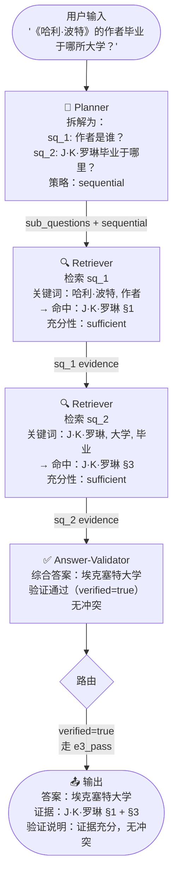

# 复杂多跳问答领域配置示例

> 文档版本：v0.1  
> 作者：沈天宇  
> 日期：2026-08-25  
> 对应配置文件：`examples/hotpotqa_example_001.json`

---

## 一、示例问题

| 项目 | 内容 |
|------|------|
| **问题** | 《哈利·波特》系列小说的作者毕业于哪所大学？ |
| **正确答案** | 埃克塞特大学 |
| **问题类型** | Bridge（桥接型）—— 需先找到中间实体（作者姓名），再用该实体检索第二步答案 |
| **难度** | Hard（跨两个文档段落，需多跳推理） |
| **数据集** | HotpotQA（distractor setting，含 8 篇干扰文档） |

### 1.1 为什么这道题是多跳？

这道题不能通过单次检索直接回答，必须经过两跳：

```
问题："《哈利·波特》的作者毕业于哪所大学？"
        ↓ 第一跳：找到中间实体
    检索"哈利·波特作者" → J·K·罗琳
        ↓ 第二跳：用中间实体找目标答案
    检索"J·K·罗琳大学" → 埃克塞特大学
```

### 1.2 黄金证据（Supporting Facts）

| # | 来源文档 | 关键句 |
|---|---------|--------|
| 1 | J·K·罗琳（维基百科）§1 | "J·K·罗琳，全名乔安妮·罗琳，英国著名作家，代表作为《哈利·波特》系列小说。" |
| 2 | J·K·罗琳（维基百科）§3 | "罗琳于1983年就读于埃克塞特大学，主修法语与古典文学，并于1987年毕业。" |

---

## 二、智能体实例配置（本题专用）

### 2.1 Planner 实例

```
模型：deepseek-v4-flash
温度：0.3
```

**输入**：
```json
{
  "question": "《哈利·波特》系列小说的作者毕业于哪所大学？",
  "conflict_flag": false,
  "plan_retry_count": 0
}
```

**输出（Planner 拆解结果）**：
```json
{
  "sub_questions": [
    {
      "id": "sq_1",
      "question": "《哈利·波特》系列小说的作者是谁？",
      "keywords": ["哈利·波特", "作者", "小说"],
      "depends_on": []
    },
    {
      "id": "sq_2",
      "question": "J·K·罗琳毕业于哪所大学？",
      "keywords": ["J·K·罗琳", "大学", "毕业", "教育背景"],
      "depends_on": ["sq_1"]
    }
  ],
  "retrieval_strategy": "sequential"
}
```

> [!NOTE]
> `sq_2` 的 `depends_on` 列出了 `sq_1`，说明 Planner 识别出这是桥接关系——必须先知道作者姓名，才能提出 sq_2 的精确检索词"J·K·罗琳"。

---

### 2.2 Retriever 实例

```
模型：deepseek-v4-flash
温度：0.1（尽量确定性，减少幻觉）
知识源：HotpotQA 本地数据集（distractor setting）
```

**sq_1 检索输入与输出**：

输入关键词：`["哈利·波特", "作者", "小说"]`

| 字段 | 内容 |
|------|------|
| 命中文档 | J·K·罗琳（维基百科） |
| 证据文本 | "J·K·罗琳，全名乔安妮·罗琳，英国著名作家，代表作为《哈利·波特》系列小说。" |
| 相关性得分 | 0.97 |
| 充分性评估 | `sufficient` |

**sq_2 检索输入与输出**：

输入关键词：`["J·K·罗琳", "大学", "毕业", "教育背景"]`（使用 sq_1 的答案精化关键词）

| 字段 | 内容 |
|------|------|
| 命中文档 | J·K·罗琳（维基百科） |
| 证据文本 | "罗琳于1983年就读于埃克塞特大学，主修法语与古典文学，并于1987年毕业。" |
| 相关性得分 | 0.95 |
| 充分性评估 | `sufficient` |

---

### 2.3 Answer-Validator 实例

```
模型：deepseek-v4-flash
温度：0.2
```

**输入**：sq_1 和 sq_2 的证据片段 + 原始问题

**验证过程**：

| 检查项 | 结果 |
|--------|------|
| sq_1 证据充分？ | ✅ 是（明确指出作者为 J·K·罗琳） |
| sq_2 证据充分？ | ✅ 是（明确指出毕业于埃克塞特大学） |
| 两条证据互相冲突？ | ✅ 无冲突 |
| 最终验证结论 | `verified = true` |

**输出**：
```json
{
  "answer": "埃克塞特大学",
  "verified": true,
  "failure_type": "none",
  "conflict_flag": false,
  "verification_note": "sq_1 证据充分：确认作者为 J·K·罗琳；sq_2 证据充分：罗琳毕业于埃克塞特大学（1987年）。两条证据无冲突，答案可信。",
  "supporting_evidence": [
    { "sq_id": "sq_1", "text": "J·K·罗琳……代表作为《哈利·波特》系列小说。", "source_title": "J·K·罗琳" },
    { "sq_id": "sq_2", "text": "罗琳于1983年就读于埃克塞特大学……并于1987年毕业。", "source_title": "J·K·罗琳" }
  ]
}
```

---

## 三、完整执行路径

### 3.1 正常路径（本题实际走的路径）



### 3.2 执行步骤清单

| 步骤 | 节点 | 操作 | 输出 |
|------|------|------|------|
| 1 | Planner | 分析问题，识别桥接关系 | sq_1 + sq_2 + sequential |
| 2 | Retriever | 检索 sq_1 | J·K·罗琳 §1（sufficient） |
| 3 | Retriever | 检索 sq_2（用 sq_1 精化关键词） | J·K·罗琳 §3（sufficient） |
| 4 | Answer-Validator | 综合证据生成答案，验证通过 | answer="埃克塞特大学"，verified=true |
| 5 | Router | 检查 `verified=true` → 路由到 END | 触发 `e3_pass` |
| 6 | 系统输出 | 返回最终结果 | 答案 + 证据 + 验证说明 |

**本题共调用 LLM 4 次**（Planner×1 + Retriever×2 + Validator×1），无重试。

---

## 四、假设失败场景（扩展说明）

### 场景 A：Retriever 证据不足（路由 e3_insufficient）

假设 sq_2 检索时未命中大学信息，Validator 输出：
```json
{
  "verified": false,
  "failure_type": "insufficient",
  "insufficient_sq_ids": ["sq_2"],
  "retrieval_supplement_request": {
    "target_sq_id": "sq_2",
    "additional_keywords": ["罗琳", "学历", "求学", "本科"],
    "reason": "当前证据未包含 J·K·罗琳的大学信息"
  }
}
```

→ 路由函数判断 `failure_type=insufficient` 且 `retrieval_retry_count < 3`  
→ 返回 Retriever，携带 `retrieval_supplement_request`，扩展关键词重新检索  
→ 最多 3 次补充检索机会

```
Retriever (sq_2 补充检索)
→ 新关键词: ["罗琳", "学历", "求学", "本科"]
→ 命中: J·K·罗琳 §3（补充检索成功）
→ 重新进入 Answer-Validator
```

---

### 场景 B：证据冲突（路由 e3_conflict）

假设两个来源分别写"埃克塞特大学"和"牛津大学"，Validator 输出：
```json
{
  "verified": false,
  "failure_type": "conflict",
  "conflict_flag": true,
  "conflict_note": "两个来源对 J·K·罗琳毕业院校描述不一致（埃克塞特 vs 牛津）",
  "conflict_pairs": [
    {
      "chunk_a": "J·K·罗琳 §3: 就读于埃克塞特大学",
      "chunk_b": "英国作家列表 §5: 牛津大学",
      "conflict_description": "大学名称不一致"
    }
  ]
}
```

→ 路由函数判断 `failure_type=conflict` 且 `plan_retry_count < 2`  
→ 返回 Planner，携带 `conflict_note`，Planner 调整分解策略（如增加"官方传记"来源限定）  
→ 最多 2 次重规划机会

---

## 五、本示例对系统设计的验证

通过这道 HotpotQA 题，可以验证以下设计决策：

| 设计决策 | 本题验证情况 |
|---------|------------|
| 子问题之间存在依赖关系（`depends_on`） | ✅ sq_2 依赖 sq_1 的答案（J·K·罗琳）精化关键词 |
| 顺序检索策略（sequential）适合桥接型问题 | ✅ 先检索 sq_1 得到中间实体，再用于 sq_2 |
| Validator 负责充分性和冲突两类验证 | ✅ 本题两项均通过 |
| 条件路由覆盖三种结果 | ✅ 正常路径走 e3_pass，假设场景覆盖 e3_insufficient 和 e3_conflict |
| 最终答案由 Validator 独家输出 | ✅ Planner 和 Retriever 不直接输出答案 |

---

## 六、系统最终输出格式

```json
{
  "question": "《哈利·波特》系列小说的作者毕业于哪所大学？",
  "answer": "埃克塞特大学",
  "verified": true,
  "supporting_evidence": [
    {
      "sq_id": "sq_1",
      "text": "J·K·罗琳，全名乔安妮·罗琳，英国著名作家，代表作为《哈利·波特》系列小说。",
      "source_title": "J·K·罗琳"
    },
    {
      "sq_id": "sq_2",
      "text": "罗琳于1983年就读于埃克塞特大学，主修法语与古典文学，并于1987年毕业。",
      "source_title": "J·K·罗琳"
    }
  ],
  "verification_note": "sq_1 证据充分：确认作者为 J·K·罗琳；sq_2 证据充分：罗琳毕业于埃克塞特大学（1987年）。两条证据无冲突，答案可信。",
  "metadata": {
    "total_llm_calls": 4,
    "retry_cycles": 0,
    "routing_path": ["planner_v0", "retriever_v0", "retriever_v0", "answer_validator_v0", "END"]
  }
}
```
