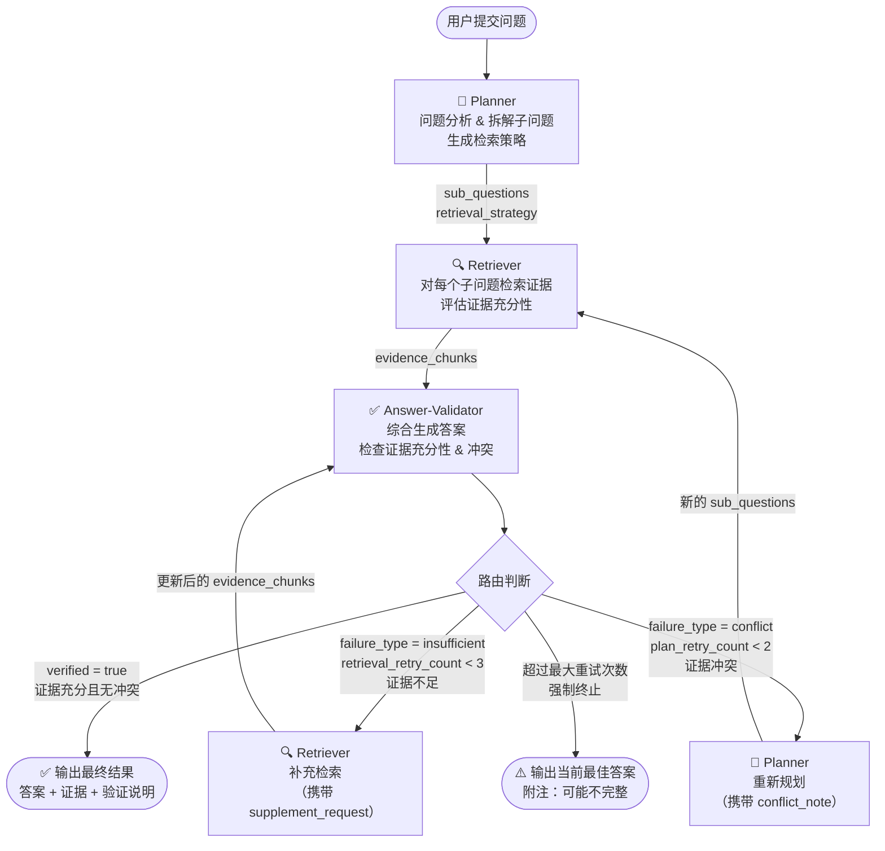

# 协同协议设计文档 v0.1

> 协议 ID：`multi_hop_qa_v0`  
> 作者：沈天宇  
> 日期：2026-08-24  
> 对应配置文件：`protocols/multi_hop_qa.json`

---

## 一、协议概述

本协议定义三个智能体（Planner、Retriever、Answer-Validator）在**复杂多跳问答任务**中的完整协同关系，包括：

- 主流程的调用顺序
- 节点之间传递的信息内容
- 三种条件路由规则（验证通过 / 证据不足 / 证据冲突）
- 最终回答权的归属
- 循环终止条件

LangGraph 承载本协议：智能体映射为节点，信息共享通过 `AgentState` 实现，条件路由通过 `add_conditional_edges` 实现。

---

## 二、主流程图

### 2.1 完整状态机图



### 2.2 简化线性视图（正常路径）

```
用户问题
    ↓
[Planner] → sub_questions + retrieval_strategy
    ↓
[Retriever] → evidence_chunks
    ↓
[Answer-Validator] → verified=true
    ↓
最终输出：answer + supporting_evidence + verification_note
```

---

## 三、节点间信息传递

### 3.1 Planner → Retriever

| 字段 | 类型 | 说明 |
|------|------|------|
| `sub_questions` | `list[SubQuestion]` | 拆解的子问题列表，每项含 `id`、`question`、`keywords`、`depends_on` |
| `retrieval_strategy` | `str` | `sequential`（顺序）或 `parallel`（并行，V0 仅支持 sequential） |

**SubQuestion 示例：**
```json
{
  "id": "sq_1",
  "question": "《哈利·波特》的作者是谁？",
  "keywords": ["哈利·波特", "作者", "J.K.罗琳"],
  "depends_on": []
}
```

---

### 3.2 Retriever → Answer-Validator

| 字段 | 类型 | 说明 |
|------|------|------|
| `evidence_chunks` | `list[EvidenceGroup]` | 每个子问题对应的证据片段组，含充分性自评 |

**EvidenceGroup 示例：**
```json
{
  "sq_id": "sq_1",
  "chunks": [
    {
      "text": "J.K.罗琳，全名乔安妮·罗琳，是英国作家，《哈利·波特》系列小说的作者。",
      "source_title": "J.K.罗琳_维基百科",
      "source_paragraph": 1,
      "relevance_score": 0.95
    }
  ],
  "sufficiency": "sufficient",
  "insufficiency_note": ""
}
```

---

### 3.3 Answer-Validator → Retriever（证据不足时）

| 字段 | 类型 | 说明 |
|------|------|------|
| `retrieval_supplement_request` | `dict` | 补充检索请求，包含目标子问题 ID、扩展关键词和原因 |
| `insufficient_sq_ids` | `list[str]` | 证据不足的子问题 ID 列表 |

**supplement_request 示例：**
```json
{
  "target_sq_id": "sq_2",
  "additional_keywords": ["出生年份", "出生地点", "国籍"],
  "reason": "当前证据只包含职业信息，缺少出生背景信息"
}
```

---

### 3.4 Answer-Validator → Planner（证据冲突时）

| 字段 | 类型 | 说明 |
|------|------|------|
| `conflict_flag` | `bool` | `true` 表示发现证据冲突，触发重规划 |
| `conflict_note` | `str` | 冲突内容的自然语言描述，帮助 Planner 调整分解策略 |
| `conflict_pairs` | `list[ConflictPair]` | 具体冲突的证据对（来源 A vs 来源 B） |

**ConflictPair 示例：**
```json
{
  "chunk_a": "J.K.罗琳_维基百科 §1: 生于1965年7月31日",
  "chunk_b": "来源B §3: 生于1966年",
  "conflict_description": "两个来源对作者出生年份的描述不一致（1965 vs 1966）"
}
```

---

### 3.5 最终系统输出

| 字段 | 类型 | 说明 |
|------|------|------|
| `answer` | `str` | 综合所有证据生成的最终答案文本 |
| `verified` | `bool` | 验证是否通过 |
| `supporting_evidence` | `list[Evidence]` | 最终答案所依赖的证据列表（含来源） |
| `verification_note` | `str` | 验证过程说明（证据是否充分、是否有冲突、如何解决） |

---

## 四、条件路由规则

### 4.1 三种路由逻辑

Answer-Validator 节点执行完毕后，由**路由函数（router）**读取共享状态，决定下一步跳转：

```python
def route_after_validator(state: AgentState) -> str:
    """LangGraph 条件路由函数"""

    # 路由 1：验证通过 → 输出
    if state["verified"]:
        return END

    # 路由 2：证据不足 + 未超重试上限 → 补充检索
    if (state["failure_type"] == "insufficient"
            and state["retrieval_retry_count"] < 3):
        return "retriever_v0"

    # 路由 3：证据冲突 + 未超重试上限 → 重规划
    if (state["failure_type"] == "conflict"
            and state["plan_retry_count"] < 2):
        return "planner_v0"

    # 路由 4：超过最大重试次数 → 强制终止，输出当前最佳答案
    return END
```

### 4.2 路由规则表

| 条件 | 跳转目标 | 说明 |
|------|---------|------|
| `verified == True` | `END` | 验证通过，输出最终结果 |
| `failure_type == "insufficient"` 且 `retrieval_retry_count < 3` | `retriever_v0` | 证据不足，补充检索（携带 supplement_request） |
| `failure_type == "conflict"` 且 `plan_retry_count < 2` | `planner_v0` | 证据冲突，重新规划（携带 conflict_note） |
| 超过任意重试上限 | `END` | 强制终止，输出当前最佳答案（附警告说明） |

### 4.3 循环终止保护

| 计数器 | 上限 | 由谁更新 |
|--------|------|---------|
| `retrieval_retry_count` | 3 次 | Retriever 每次执行后 +1 |
| `plan_retry_count` | 2 次 | Planner 每次重规划后 +1 |
| `validation_retry_count` | 2 次 | Answer-Validator 每次执行后 +1 |

---

## 五、并行执行说明

### V0（当前）：全串行

```
Planner → Retriever（sq_1）→ Retriever（sq_2）→ ... → Answer-Validator
```

所有子问题按顺序检索，节点串行执行。

### V1（规划中）：Retriever 内部并行

```
Planner → [Retriever(sq_1) ‖ Retriever(sq_2) ‖ Retriever(sq_3)] → Answer-Validator
```

当 `retrieval_strategy == "parallel"` 时，对多个子问题同时并行检索，合并结果后进入 Answer-Validator。需要 LangGraph 的 `Send` API 或 `map-reduce` 模式实现。

---

## 六、最终回答权

**Answer-Validator 拥有最终回答权。**

- 它是唯一有权将 `verified = true` 写入共享状态的节点；
- 它决定输出哪些证据作为支撑；
- 当强制终止时，也由它写入当前最佳答案（即使未验证）。

Planner 和 Retriever **不能**直接输出答案，只能通过修改共享状态影响最终结果。

---

## 七、LangGraph 实现对应关系

| 协议概念 | LangGraph 实现 |
|---------|--------------|
| 智能体节点 | `graph.add_node("planner_v0", planner_fn)` |
| 固定边（Planner→Retriever）| `graph.add_edge("planner_v0", "retriever_v0")` |
| 条件路由（Validator后）| `graph.add_conditional_edges("answer_validator_v0", route_after_validator)` |
| 共享状态 | `class AgentState(TypedDict): ...` |
| 入口节点 | `graph.set_entry_point("planner_v0")` |
| 持久化（可选）| `MemorySaver` 或 `SqliteSaver` 作为 Checkpointer |

**LangGraph 图构建代码骨架（V0）：**
```python
from langgraph.graph import StateGraph, END
from langgraph.checkpoint.memory import MemorySaver

# 构建图
graph = StateGraph(AgentState)

# 注册节点
graph.add_node("planner_v0",          planner_fn)
graph.add_node("retriever_v0",        retriever_fn)
graph.add_node("answer_validator_v0", answer_validator_fn)

# 设置入口
graph.set_entry_point("planner_v0")

# 固定边
graph.add_edge("planner_v0",   "retriever_v0")
graph.add_edge("retriever_v0", "answer_validator_v0")

# 条件路由
graph.add_conditional_edges(
    "answer_validator_v0",
    route_after_validator,
    {
        "retriever_v0": "retriever_v0",
        "planner_v0":   "planner_v0",
        END:             END
    }
)

# 编译（加入 checkpointer 支持多轮调试）
app = graph.compile(checkpointer=MemorySaver())
```

---

## 八、协议版本规划

| 版本 | 新增内容 |
|------|---------|
| **v0.1（当前）** | 三节点串行、两种失败路由、三种计数器保护 |
| **v0.2** | Retriever 子问题并行（LangGraph Send API） |
| **v1.0** | 协议从 JSON 动态加载，支持任意节点图配置 |
| **v2.0** | 动态任务分配、智能体副本、负载均衡 |
