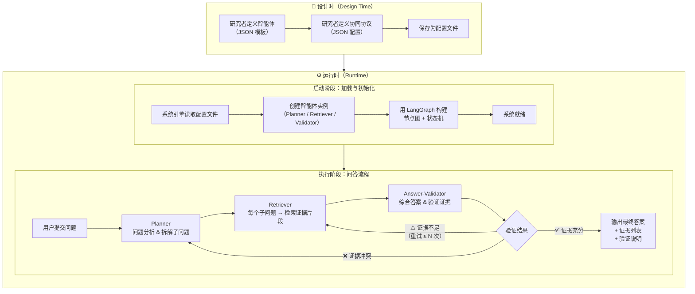

# 系统总体设计文档 v0.1

> 文档版本：v0.1  
> 作者：沈天宇  
> 日期：2026-08-22  
> 状态：设计阶段（供导师审阅）

---

## 一、系统目标

### 1.1 核心定位

本系统是一个**面向复杂多跳问答任务、可配置、可扩展的多智能体协同平台**。

系统的核心目标有三层：

1. **任务目标**：能够回答需要多步推理和多轮检索才能解决的复杂问题（如 HotpotQA 类型，需跨多段文档组合推理）；
2. **工程目标**：智能体的角色定义与协同协议可以通过配置文件（JSON）描述，系统运行时加载配置、创建实例并执行，而不是将逻辑硬编码在代码中；
3. **研究目标**：在 LangGraph 提供的状态机底层引擎之上，设计并验证自定义的协同调度机制，包括验证失败时的动态重规划、多轮反思与证据冲突处理等，形成可发表的研究贡献。

### 1.2 系统使命句

> 让开发者通过配置文件定义"有哪些智能体、怎样协作"，系统在运行时自动加载并完成复杂多跳问答，同时支持研究者修改协同策略进行实验。

---

## 二、系统边界（V0 版本）

### 2.1 V0 解决什么

| 能力 | 说明 |
|------|------|
| 三角色协同问答 | 支持 Planner、Retriever、Answer-Validator 三类智能体协同 |
| JSON 配置驱动 | 智能体定义和协同协议通过 JSON 文件描述，运行时加载 |
| 多跳问答流程 | 支持问题拆解 → 子问题检索 → 证据整合 → 答案验证的完整流程 |
| 验证反馈循环 | 证据不足时自动回到 Retriever 补充检索（简单闭环） |
| 可替换知识源 | 检索智能体的知识源在配置中指定，可换不同文档库 |

### 2.2 V0 **不**解决什么

| 不做的能力 | 留给哪个版本 | 原因 |
|-----------|------------|------|
| 图形化设计器（前端界面） | V3 | 当前阶段用 JSON 文件代替，优先验证机制 |
| 分布式部署 / 容器化 | V2+ | 不是研究核心 |
| 智能体副本 / 负载均衡 | V2 | 先跑通单实例 |
| 多领域扩展（医疗/法律等） | V1 | V0 只支持复杂多跳问答场景 |
| 真实 Web 检索（联网） | V1 | V0 使用本地模拟知识库或 HotpotQA 数据集 |
| 多用户并发 | V2+ | V0 为单用户、单次问答 |

### 2.3 版本路线图

```
V0（当前）：三角色固定 + JSON 配置加载 + 单场景跑通
    ↓
V1：智能体模板完全可配置，知识源可替换，协议可配置
    ↓
V2：动态任务分配，并行检索，智能体副本机制
    ↓
V3：前端设计器，可视化配置，多领域扩展
```

---

## 三、设计时 vs 运行时职责划分

系统分为两个独立阶段，职责完全分离：

### 3.1 设计时（Design Time）

**谁在做**：研究者 / 开发者  
**做什么**：定义系统"有什么、怎么合作"

| 职责 | 具体内容 |
|------|---------|
| 定义智能体 | 为每类智能体编写 JSON 模板，描述角色、知识源、推理方式、邻居关系等 |
| 定义协同协议 | 编写协议配置，描述调用顺序、状态跳转、失败处理、信息传递格式 |
| 保存配置 | 将模板和协议保存为 `.json` 文件（V0），后续可升级为数据库或可视化设计器 |

设计时产出物：
```
system-design/
├── agents/
│   ├── planner.json          # 规划智能体模板
│   ├── retriever.json        # 检索智能体模板
│   └── answer_validator.json # 回答与验证智能体模板
└── protocols/
    └── multi_hop_qa.json     # 复杂多跳问答协同协议
```

### 3.2 运行时（Runtime）

**谁在做**：系统引擎（自动执行）  
**做什么**：加载配置、创建实例、完成问答

| 步骤 | 职责 |
|------|------|
| 加载配置 | 读取 JSON 模板文件（智能体定义 + 协同协议） |
| 实例化智能体 | 根据模板创建智能体实例（绑定具体的 LLM、工具、知识库） |
| 构建图结构 | 根据协议配置，用 LangGraph 构建节点图和状态机 |
| 执行问答 | 接收用户问题，按协议驱动智能体协同，完成规划→检索→验证流程 |
| 返回结果 | 输出最终答案、使用的证据片段、验证说明 |

### 3.3 职责对比

| 维度 | 设计时 | 运行时 |
|------|--------|--------|
| 时机 | 系统开发 / 部署前 | 用户提交问题时 |
| 执行者 | 研究者 / 开发者 | 系统引擎（自动） |
| 输入 | 研究需求、任务场景 | 用户问题 |
| 输出 | JSON 配置文件（模板） | 答案 + 证据 + 验证说明 |
| 修改频率 | 低（研究实验时修改） | 高（每次问答都执行） |

---

## 四、LangGraph 在系统中的位置

LangGraph 是系统的**底层协同引擎**，而不是系统的全部。

### 4.1 系统分层架构

```
┌─────────────────────────────────────────────────────────┐
│                   应用层（Application Layer）              │
│   用户输入 / 配置界面（V0: JSON文件） / 结果展示             │
├─────────────────────────────────────────────────────────┤
│                 协同调度层（Orchestration Layer）           │
│   智能体模板加载器 / 协议解析器 / 实例管理器                  │
│   【本研究的核心贡献：协同机制设计在这一层】                   │
├─────────────────────────────────────────────────────────┤
│                底层引擎层（Engine Layer）                   │
│            LangGraph（状态机 / 节点图 / 条件路由）            │
│            langchain-core（LLM 调用 / 工具调用）             │
├─────────────────────────────────────────────────────────┤
│                  基础设施层（Infrastructure）               │
│        LLM API（OpenAI / 开源模型） / 知识库 / 检索工具       │
└─────────────────────────────────────────────────────────┘
```

### 4.2 LangGraph 承担什么

| LangGraph 负责 | 本研究在 LangGraph 之上设计 |
|--------------|--------------------------|
| 节点（Node）：智能体执行单元 | 节点内的智能体逻辑（提示词、推理策略） |
| 边（Edge）：节点间跳转规则 | 条件路由函数（何时重规划、何时验证通过） |
| 共享状态（State）：跨节点信息 | 状态结构定义（子问题、证据、冲突标记） |
| Checkpointer：状态持久化 | 多轮反思时的状态管理 |
| 执行引擎：驱动图运行 | — |

**类比**：LangGraph 相当于 PyTorch，本研究相当于用 PyTorch 设计的具体神经网络架构。论文贡献在于"架构设计"，而不是"发明了 PyTorch"。

---

## 五、整体流程：从"用户配置"到"返回答案"

### 5.1 文字描述

**阶段一（设计时）**：研究者根据目标任务场景（复杂多跳问答），编写三类智能体的 JSON 定义模板，以及描述三者协同关系的协议配置文件。

**阶段二（运行时启动）**：系统引擎读取 JSON 配置，完成以下操作：
1. 解析智能体模板，绑定 LLM 和工具，创建智能体实例；
2. 解析协同协议，用 LangGraph 构建节点图、定义共享 State、注册条件路由函数；
3. 系统就绪，等待用户输入。

**阶段三（问答执行）**：用户提交问题后：
1. 问题进入 `Planner` 节点，分析并拆解为若干子问题；
2. 子问题列表传入 `Retriever` 节点，对每个子问题检索证据片段；
3. 证据列表传入 `Answer-Validator` 节点，综合生成答案，检查证据充分性与冲突；
4. 若验证通过，输出最终答案 + 证据 + 验证说明；
5. 若证据不足，条件路由触发，回到 `Retriever` 补充检索（最多重试 N 次）；
6. 若证据冲突，进入冲突处理子流程（V0 简化版：标记冲突并回到 Planner 重规划）。

### 5.2 Mermaid 流程图



### 5.3 关键数据流

```
用户问题（string）
    ↓ Planner
AgentState {
    question: string,
    sub_questions: list[string],   ← Planner 产生
    retrieval_strategy: string
}
    ↓ Retriever
AgentState {
    ...
    evidence_chunks: list[Evidence],  ← Retriever 产生
    retrieval_count: int
}
    ↓ Answer-Validator
AgentState {
    ...
    answer: string,               ← Answer-Validator 产生
    verified: bool,
    conflict_flag: bool,
    verification_note: string
}
    ↓ 条件路由
→ 输出（verified=True）
→ 返回 Retriever（verified=False, 证据不足）
→ 返回 Planner（conflict_flag=True, 证据冲突）
```

---

## 六、下一步

| 任务 | 对应文档 |
|------|---------|
| 为三类智能体各写一份 JSON 模板 | `任务4 — 智能体定义模板 v0.1` |
| 写协同协议配置 | `任务5 — 协同协议设计 v0.1` |
| 用 HotpotQA 一道题填满模板 | `任务6 — 领域配置示例` |
| 写代码实现计划 | `任务7 — 分阶段实现计划` |
| 写代码 | `任务8 — LangGraph V0 原型` |
